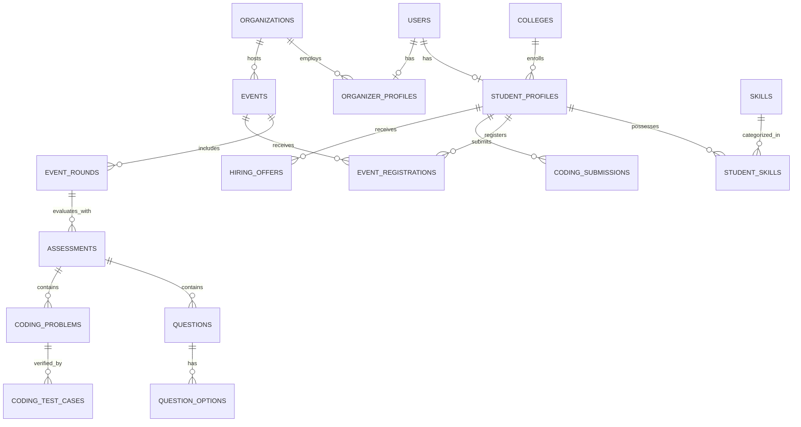

# Proup Backend REST API Specification

> **Platform:** Proup — Event-Based Talent Discovery & Hiring  
> **Backend Framework:** FastAPI (Python 3.12+)  
> **ORM & Database:** SQLAlchemy 2.0 (Async) + aiosqlite / asyncpg (PostgreSQL)  
> **API Version:** 1.0.0  
> **Base URL:** `/api/v1`  
> **Interactive Documentation:** Swagger UI at `/docs` | ReDoc at `/redoc` | OpenAPI JSON at `/api/v1/openapi.json`  

---

## 1. Architecture & Protocol Overview

### 1.1 Base Configuration
- **Server Default Port:** `http://localhost:8000`
- **API Prefix:** `/api/v1`
- **Data Exchange Format:** `application/json`
- **Character Encoding:** `UTF-8`
- **CORS Allowed Origins:** `http://localhost:3000`, `http://localhost:5173`, `http://127.0.0.1:3000`, `http://127.0.0.1:5173`

### 1.2 Authentication & Security Scheme
- **Mechanism:** OAuth2 with Bearer JWT tokens (`Authorization: Bearer <access_token>`).
- **Signature Algorithm:** HMAC-SHA256 (`HS256`).
- **Password Hashing:** `bcrypt` via `passlib`.
- **Token Expiry:**
  - Access Token: `60 minutes`
  - Refresh Token: `7 days`
- **JWT Payload Structure:**
  ```json
  {
    "sub": "101",
    "email": "student@college.edu",
    "role": "student",
    "org_id": null,
    "exp": 1729864200,
    "type": "access"
  }
  ```

### 1.3 Role-Based Access Control (RBAC)
Every route enforces fine-grained access using FastAPI dependency injection (`app.api.deps`):

| Role Guard | Allowed Roles | Description |
| :--- | :--- | :--- |
| `Public` | Anyone | No authorization header required. |
| `get_current_user` | Any authenticated user | Valid bearer token required. |
| `require_role(["student"])` | `student` | Candidate-specific capabilities. |
| `require_verified_organizer` | `organizer` (approved), `admin` | Organizers with `verification_status == "APPROVED"`. |
| `require_admin` | `admin` | Elevated administrative actions (verification, moderation, analytics). |

### 1.4 Standard API Response Envelopes

All domain responses conform to generic Pydantic wrapper models (`app.schemas.common`):

#### Successful Response (`APIResponse[T]`)
```json
{
  "success": true,
  "message": "Operation completed successfully",
  "data": {}
}
```

#### HTTP Exception Response
```json
{
  "detail": "Descriptive error message"
}
```

### 1.5 Common HTTP Status Codes
| Status Code | Reason | Usage Scenario |
| :--- | :--- | :--- |
| `200 OK` | Request succeeded | Standard fetch, update, or action payload. |
| `201 Created` | Resource created | Successful registration, event, question, or offer creation. |
| `400 Bad Request` | Client error | Invalid inputs, event not open, bad status transitions. |
| `401 Unauthorized` | Authentication failed | Missing, malformed, or expired JWT token. |
| `403 Forbidden` | Access denied | Unauthorized role or pending organizer account. |
| `404 Not Found` | Resource missing | Student profile, event, question, or offer not found. |
| `409 Conflict` | Duplicate state | Email already registered, or duplicate event registration. |
| `422 Unprocessable` | Schema validation error | Invalid Pydantic types, missing required fields. |
| `500 Internal Error` | Unexpected failure | Uncaught server or database error. |

---

## 2. Global Endpoints

### 2.1 Health Check
- **Endpoint:** `GET /health`
- **Access:** Public
- **Description:** Verifies service liveness, deployed version, and operating environment.
- **Response (200 OK):**
```json
{
  "status": "healthy",
  "version": "1.0.0",
  "environment": "development"
}
```

### 2.2 Root Greeting & Navigation
- **Endpoint:** `GET /`
- **Access:** Public
- **Description:** Returns platform introduction and quick documentation links.
- **Response (200 OK):**
```json
{
  "message": "Welcome to Proup API — Meet. Compete. Get Hired.",
  "documentation": "/docs",
  "health": "/health"
}
```

---

## 3. Domain 1: Authentication Router (`/api/v1/auth`)

Mounted at prefix `/api/v1/auth` with OpenAPI tag `Authentication`.

### 3.1 Student Registration
- **Endpoint:** `POST /api/v1/auth/register/student`
- **Access:** Public
- **Status:** `201 Created`
- **Request Body (`StudentRegisterRequest`):**
```json
{
  "email": "student@nie.ac.in",
  "password": "Password123!",
  "name": "Manvith Gowda",
  "college_id": 1,
  "github_url": "https://github.com/manvithgowda",
  "linkedin_url": "https://linkedin.com/in/manvithgowda",
  "bio": "Aspiring systems & backend software engineer.",
  "skills": [
    { "skill_id": 1, "proficiency": "ADVANCED" },
    { "skill_id": 2, "proficiency": "ADVANCED" }
  ]
}
```
- **Response (201 Created):**
```json
{
  "success": true,
  "message": "Student registered successfully",
  "data": {
    "user_id": 3,
    "email": "student@nie.ac.in",
    "role": "student",
    "verification_status": null,
    "organization_id": null
  }
}
```
- **Error Responses:**
  - `409 Conflict`: `{"detail": "Email already registered"}`
  - `422 Unprocessable Entity`: Field validation error (e.g. password < 6 characters).

---

### 3.2 Organizer Registration
- **Endpoint:** `POST /api/v1/auth/register/organizer`
- **Access:** Public
- **Status:** `201 Created`
- **Description:** Registers an organizer account. If the organization (identified by CIN) doesn't exist, it creates the organization record. Sets the account verification status to `PENDING` awaiting admin approval.
- **Request Body (`OrganizerRegisterRequest`):**
```json
{
  "email": "recruiter@deepmind.com",
  "password": "Password123!",
  "organization": {
    "name": "Google DeepMind Labs",
    "cin": "U72900KA2021PTC148900",
    "email": "careers@deepmind.com",
    "website": "https://deepmind.google"
  }
}
```
- **Response (201 Created):**
```json
{
  "success": true,
  "message": "Organizer registration submitted for admin approval",
  "data": {
    "user_id": 2,
    "email": "recruiter@deepmind.com",
    "role": "organizer",
    "verification_status": "PENDING",
    "organization_id": 1
  }
}
```
- **Error Responses:**
  - `409 Conflict`: `{"detail": "Email already registered"}`

---

### 3.3 User Login
- **Endpoint:** `POST /api/v1/auth/login`
- **Access:** Public
- **Status:** `200 OK`
- **Request Body (`LoginRequest`):**
```json
{
  "email": "student@nie.ac.in",
  "password": "Password123!"
}
```
- **Response (200 OK):**
```json
{
  "success": true,
  "message": "Login successful",
  "data": {
    "access_token": "eyJhbGciOiJIUzI1NiIsInR5cCI6IkpXVCJ9...",
    "refresh_token": "eyJhbGciOiJIUzI1NiIsInR5cCI6IkpXVCJ9...",
    "token_type": "bearer",
    "expires_in": 3600,
    "user": {
      "user_id": 3,
      "email": "student@nie.ac.in",
      "role": "student",
      "verification_status": null,
      "organization_id": null
    }
  }
}
```
- **Error Responses:**
  - `401 Unauthorized`: `{"detail": "Invalid email or password"}`

---

### 3.4 Get Current Authenticated User (`/me`)
- **Endpoint:** `GET /api/v1/auth/me`
- **Access:** Authenticated (Any role)
- **Headers:** `Authorization: Bearer <access_token>`
- **Response (200 OK):**
```json
{
  "success": true,
  "message": "Success",
  "data": {
    "user_id": 3,
    "email": "student@nie.ac.in",
    "role": "student",
    "verification_status": null,
    "organization_id": null
  }
}
```
- **Error Responses:**
  - `401 Unauthorized`: `{"detail": "Could not validate credentials"}`

---

## 4. Domain 2: Students Router (`/api/v1/students`)

Mounted at prefix `/api/v1/students` with OpenAPI tag `Students`.

### 4.1 Get Logged-In Student Profile
- **Endpoint:** `GET /api/v1/students/me/profile`
- **Access:** Role: `student`
- **Headers:** `Authorization: Bearer <student_token>`
- **Response (200 OK):**
```json
{
  "success": true,
  "message": "Success",
  "data": {
    "user_id": 3,
    "name": "Manvith Gowda",
    "email": "student@nie.ac.in",
    "college": {
      "college_id": 1,
      "name": "National Institute of Engineering",
      "location": "Mysuru"
    },
    "github_url": "https://github.com/manvithgowda",
    "linkedin_url": "https://linkedin.com/in/manvithgowda",
    "resume_url": null,
    "bio": "Aspiring systems & backend software engineer.",
    "skills": [
      {
        "skill_id": 1,
        "name": "Python",
        "proficiency": "ADVANCED"
      },
      {
        "skill_id": 2,
        "name": "FastAPI",
        "proficiency": "ADVANCED"
      }
    ]
  }
}
```
- **Error Responses:**
  - `403 Forbidden`: User is not a student.
  - `404 Not Found`: Profile does not exist.

---

### 4.2 Update Student Profile
- **Endpoint:** `PUT /api/v1/students/me/profile`
- **Access:** Role: `student`
- **Headers:** `Authorization: Bearer <student_token>`
- **Request Body (`StudentProfileUpdate`):**
```json
{
  "name": "Manvith Gowda",
  "college_id": 1,
  "github_url": "https://github.com/manvithgowda",
  "linkedin_url": "https://linkedin.com/in/manvithgowda",
  "resume_url": "https://storage.proup.io/resumes/manvith.pdf",
  "bio": "Specializing in distributed systems, async Python, and event-driven architecture."
}
```
- **Response (200 OK):** Returns the refreshed `StudentProfileResponse`.

---

### 4.3 Add or Update Skill in Profile
- **Endpoint:** `POST /api/v1/students/me/skills`
- **Access:** Role: `student`
- **Headers:** `Authorization: Bearer <student_token>`
- **Request Body (`AddSkillRequest`):**
```json
{
  "skill_id": 3,
  "proficiency": "INTERMEDIATE"
}
```
- **Response (200 OK):**
```json
{
  "success": true,
  "message": "Skill added successfully",
  "data": {
    "skill_id": 3
  }
}
```
- **Error Responses:**
  - `404 Not Found`: `{"detail": "Skill not found"}`

---

### 4.4 Remove Skill from Profile
- **Endpoint:** `DELETE /api/v1/students/me/skills/{skill_id}`
- **Access:** Role: `student`
- **Path Parameter:** `skill_id` (integer)
- **Response (200 OK):**
```json
{
  "success": true,
  "message": "Skill removed successfully",
  "data": {
    "skill_id": 3
  }
}
```
- **Error Responses:**
  - `404 Not Found`: `{"detail": "Student skill not found"}`

---

### 4.5 Get Student Verified Achievements
- **Endpoint:** `GET /api/v1/students/me/achievements`
- **Access:** Role: `student`
- **Headers:** `Authorization: Bearer <student_token>`
- **Description:** Returns the student's verified achievements, awards, and credentials earned through event participation (satisfies PRD Section 5.2 Achievements Page).
- **Response (200 OK):**
```json
{
  "success": true,
  "message": "Success",
  "data": [
    {
      "id": 1,
      "achievement_id": 1,
      "name": "First Place - Backend Sprint 2026",
      "description": "Awarded for highest score in the National Systems Challenge",
      "event_id": 1,
      "event_title": "National Backend Python Challenge",
      "certificate_url": "https://storage.proup.io/certs/cert-101.pdf",
      "awarded_at": "2026-10-25T14:00:00Z"
    }
  ]
}
```

---

### 4.6 Get Student Event Registrations ("My Events")
- **Endpoint:** `GET /api/v1/students/me/registrations`
- **Access:** Role: `student`
- **Headers:** `Authorization: Bearer <student_token>`
- **Description:** Returns the student's historical and ongoing event signups, feeding into their participation track record.
- **Response (200 OK):**
```json
{
  "success": true,
  "message": "Success",
  "data": [
    {
      "registration_id": 1,
      "event_id": 1,
      "event_title": "National Backend Python Challenge",
      "event_date": "2026-11-08T09:30:00Z",
      "status": "REGISTERED",
      "registered_at": "2026-10-25T12:00:00Z"
    }
  ]
}
```

---

## 5. Domain 3: Events Router (`/api/v1/events`)

Mounted at prefix `/api/v1/events` with OpenAPI tag `Events`.

### 5.1 List / Discover Events
- **Endpoint:** `GET /api/v1/events`
- **Access:** Public
- **Query Parameters:**
  | Parameter | Type | Default | Description |
  | :--- | :--- | :--- | :--- |
  | `status` | string | `"LIVE"` | Event status filter (`LIVE`, `DRAFT`, `APPROVED`, `ALL`) |
  | `event_type` | string | `null` | Filter by type (`HIRING_CHALLENGE`, `HACKATHON`, `COMPETITION`, `WORKSHOP`) |
  | `search` | string | `null` | Keyword matching against event title or description |
  | `page` | integer | `1` | Pagination page number (`>= 1`) |
  | `limit` | integer | `20` | Items per page (`1` to `100`) |
- **Response (200 OK):**
```json
{
  "success": true,
  "message": "Success",
  "data": [
    {
      "event_id": 1,
      "organization_id": 1,
      "created_by": 2,
      "title": "National Systems & Backend Hiring Challenge 2026",
      "description": "High-velocity 3-stage competition for top engineers. Top performers receive direct hiring offers.",
      "event_type": "HIRING_CHALLENGE",
      "event_mode": "ONLINE",
      "event_date": "2026-11-08T09:30:00Z",
      "registration_deadline": "2026-11-04T18:00:00Z",
      "location": "Remote",
      "max_participants": 500,
      "status": "LIVE",
      "created_at": "2026-10-25T09:00:00Z",
      "organization": {
        "organization_id": 1,
        "name": "Google DeepMind Labs",
        "website": "https://deepmind.google"
      },
      "rounds_count": 3
    }
  ]
}
```

---

### 5.2 Get Skill-Based Event Recommendations
- **Endpoint:** `GET /api/v1/events/recommendations`
- **Access:** Role: `student`
- **Headers:** `Authorization: Bearer <student_token>`
- **Description:** Runs the recommendation engine (`app.services.recommendation`) calculating proficiency weights and affinity scores based on student profile skills vs event content.
- **Response (200 OK):**
```json
{
  "success": true,
  "message": "Success",
  "data": [
    {
      "event_id": 1,
      "organization_id": 1,
      "created_by": 2,
      "title": "National Systems & Backend Hiring Challenge 2026",
      "description": "High-velocity 3-stage competition for top engineers.",
      "event_type": "HIRING_CHALLENGE",
      "event_mode": "ONLINE",
      "event_date": "2026-11-08T09:30:00Z",
      "registration_deadline": "2026-11-04T18:00:00Z",
      "location": "Remote",
      "max_participants": 500,
      "status": "LIVE",
      "created_at": "2026-10-25T09:00:00Z",
      "organization": {
        "organization_id": 1,
        "name": "Google DeepMind Labs",
        "website": "https://deepmind.google"
      },
      "rounds_count": 3,
      "match_score": 85.0
    }
  ]
}
```

---

### 5.3 Get Event Details
- **Endpoint:** `GET /api/v1/events/{event_id}`
- **Access:** Public
- **Path Parameter:** `event_id` (integer)
- **Response (200 OK):** Single `EventResponse` object with nested organization brief and count of rounds.
- **Error Responses:**
  - `404 Not Found`: `{"detail": "Event not found"}`

---

### 5.4 Create Event
- **Endpoint:** `POST /api/v1/events`
- **Access:** Verified Organizer or Admin (`require_verified_organizer`)
- **Status:** `201 Created`
- **Description:** Creates an event belonging to the organizer's affiliated organization. Defaults to `DRAFT` status awaiting publication/moderation.
- **Request Body (`EventCreate`):**
```json
{
  "title": "Cloud Distributed Systems Hackathon",
  "description": "A 48-hour competitive sprint solving large-scale high-throughput messaging challenges.",
  "event_type": "HACKATHON",
  "event_mode": "ONLINE",
  "event_date": "2026-11-20T10:00:00Z",
  "registration_deadline": "2026-11-15T23:59:59Z",
  "location": "Virtual",
  "max_participants": 250
}
```
- **Response (201 Created):**
```json
{
  "success": true,
  "message": "Event created in DRAFT status",
  "data": {
    "event_id": 2,
    "status": "DRAFT"
  }
}
```
- **Error Responses:**
  - `403 Forbidden`: `{"detail": "Organizer account is pending admin approval or has been rejected."}`

---

### 5.5 Register for Event
- **Endpoint:** `POST /api/v1/events/{event_id}/register`
- **Access:** Role: `student`
- **Headers:** `Authorization: Bearer <student_token>`
- **Path Parameter:** `event_id` (integer)
- **Description:** Enrolls student in event if status is `LIVE` or `APPROVED`.
- **Response (200 OK):**
```json
{
  "success": true,
  "message": "Successfully registered for event",
  "data": {
    "event_id": 1
  }
}
```
- **Error Responses:**
  - `400 Bad Request`: `{"detail": "Event is not currently open for registrations"}`
  - `404 Not Found`: `{"detail": "Event not found"}`
  - `409 Conflict`: `{"detail": "Already registered for this event"}`

---

### 5.6 Update Event Details
- **Endpoint:** `PUT /api/v1/events/{event_id}`
- **Access:** Verified Organizer (Event Creator) or Admin
- **Path Parameter:** `event_id` (integer)
- **Description:** Allows the organizer who created the event or platform admin to update event metadata (satisfies PRD Section 5.4 Organizer Event Creation & Management).
- **Request Body (`EventUpdate`):**
```json
{
  "title": "National Backend Python Challenge 2026 (Updated)",
  "max_participants": 750
}
```
- **Response (200 OK):**
```json
{
  "success": true,
  "message": "Event updated successfully",
  "data": {
    "event_id": 1
  }
}
```
- **Error Responses:**
  - `403 Forbidden`: `{"detail": "Not authorized to edit this event"}`
  - `404 Not Found`: `{"detail": "Event not found"}`

---

### 5.7 Get Event Competition Rounds
- **Endpoint:** `GET /api/v1/events/{event_id}/rounds`
- **Access:** Public
- **Path Parameter:** `event_id` (integer)
- **Description:** Retrieves all multi-stage competition rounds configured for the event.
- **Response (200 OK):**
```json
{
  "success": true,
  "message": "Success",
  "data": [
    {
      "round_id": 1,
      "event_id": 1,
      "round_number": 1,
      "name": "CS Fundamentals & Aptitude",
      "round_type": "APTITUDE",
      "description": "60 questions evaluating algorithms, operating systems, and DBMS",
      "start_time": "2026-11-08T09:30:00Z",
      "end_time": "2026-11-08T10:30:00Z",
      "duration_minutes": 60,
      "total_marks": 100.0,
      "passing_marks": 60.0,
      "status": "UPCOMING"
    }
  ]
}
```

---

## 6. Domain 4: Assessments Router (`/api/v1/assessments`)

Mounted at prefix `/api/v1/assessments` with OpenAPI tag `Assessments`.

### 6.1 Get Assessment Questions
- **Endpoint:** `GET /api/v1/assessments/{assessment_id}/questions`
- **Access:** Authenticated (Any role)
- **Security Logic:** When invoked by a user with role `student`, the `is_correct` boolean field on options is sanitized to `null` to prevent answer leakage.
- **Path Parameter:** `assessment_id` (integer)
- **Response (200 OK):**
```json
{
  "success": true,
  "message": "Success",
  "data": [
    {
      "question_id": 1,
      "assessment_id": 1,
      "question_text": "What is the average time complexity of lookups in a Python dictionary?",
      "question_type": "MCQ",
      "marks": 2.0,
      "negative_marks": 0.5,
      "options": [
        {
          "option_id": 1,
          "option_text": "O(1)",
          "is_correct": null
        },
        {
          "option_id": 2,
          "option_text": "O(log n)",
          "is_correct": null
        },
        {
          "option_id": 3,
          "option_text": "O(n)",
          "is_correct": null
        }
      ]
    }
  ]
}
```

---

### 6.2 Add Question to Assessment
- **Endpoint:** `POST /api/v1/assessments/{assessment_id}/questions`
- **Access:** Verified Organizer or Admin
- **Status:** `201 Created`
- **Path Parameter:** `assessment_id` (integer)
- **Request Body (`QuestionCreate`):**
```json
{
  "question_text": "Which HTTP status code signifies that a resource was successfully created?",
  "question_type": "MCQ",
  "marks": 2.0,
  "negative_marks": 0.5,
  "options": [
    { "option_text": "200 OK", "is_correct": false },
    { "option_text": "201 Created", "is_correct": true },
    { "option_text": "204 No Content", "is_correct": false },
    { "option_text": "202 Accepted", "is_correct": false }
  ]
}
```
- **Response (201 Created):**
```json
{
  "success": true,
  "message": "Question created successfully",
  "data": {
    "question_id": 12
  }
}
```

---

### 6.3 Submit Assessment Answers & Automated Grading
- **Endpoint:** `POST /api/v1/assessments/{assessment_id}/submit`
- **Access:** Role: `student`
- **Path Parameter:** `assessment_id` (integer)
- **Description:** Runs `app.services.assessment_evaluator` to calculate question marks, deduce negative marks, calculate percentage against total marks, verify passing score, record every `Answer` row, and store the cumulative `AssessmentResult`.
- **Request Body (`AssessmentSubmitRequest`):**
```json
{
  "submissions": [
    { "question_id": 1, "selected_option_id": 1 },
    { "question_id": 2, "selected_option_id": 4 }
  ]
}
```
- **Response (200 OK):**
```json
{
  "success": true,
  "message": "Assessment evaluated successfully",
  "data": {
    "result_id": 1,
    "assessment_id": 1,
    "student_id": 3,
    "score": 85.0,
    "total_marks": 100.0,
    "percentage": 85.0,
    "passed": true,
    "rank": null
  }
}
```

---

## 7. Domain 5: Coding Arena Router (`/api/v1/coding`)

Mounted at prefix `/api/v1/coding` with OpenAPI tag `Coding Arena`.

### 7.1 Get Coding Problem Details
- **Endpoint:** `GET /api/v1/coding/problems/{problem_id}`
- **Access:** Authenticated (Any role)
- **Security Logic:** If requested by a `student`, test cases with `is_hidden = true` are omitted from the response.
- **Path Parameter:** `problem_id` (integer)
- **Response (200 OK):**
```json
{
  "success": true,
  "message": "Success",
  "data": {
    "problem_id": 1,
    "assessment_id": 2,
    "title": "LRU Cache Implementation",
    "description": "Design a data structure that follows the constraints of a Least Recently Used (LRU) cache.",
    "input_format": "Commands array and values array",
    "output_format": "Results of get and put operations",
    "constraints": "1 <= capacity <= 3000, 0 <= key <= 10^4",
    "difficulty": "HARD",
    "test_cases": [
      {
        "test_case_id": 1,
        "problem_id": 1,
        "input_data": "[\"LRUCache\", \"put\", \"get\"]\\n[[2], [1, 1], [1]]",
        "expected_output": "[null, null, 1]",
        "marks": 20.0,
        "is_hidden": false
      }
    ]
  }
}
```
- **Error Responses:**
  - `404 Not Found`: `{"detail": "Coding problem not found"}`

---

### 7.2 Add Test Case to Problem
- **Endpoint:** `POST /api/v1/coding/problems/{problem_id}/test-cases`
- **Access:** Verified Organizer or Admin
- **Status:** `201 Created`
- **Path Parameter:** `problem_id` (integer)
- **Request Body (`TestCaseCreate`):**
```json
{
  "input_data": "[\"LRUCache\",\"put\",\"put\",\"get\",\"put\",\"get\",\"get\"]\\n[[2],[1,1],[2,2],[1],[3,3],[2],[3]]",
  "expected_output": "[null,null,null,1,null,-1,3]",
  "marks": 30.0,
  "is_hidden": true
}
```
- **Response (201 Created):**
```json
{
  "success": true,
  "message": "Test case created",
  "data": {
    "test_case_id": 5
  }
}
```

---

### 7.3 Submit Code Solution for Evaluation
- **Endpoint:** `POST /api/v1/coding/problems/{problem_id}/submit`
- **Access:** Role: `student`
- **Path Parameter:** `problem_id` (integer)
- **Description:** Sends source code to `app.services.coding_runner`, grades test cases, records `CodingSubmission`, and returns pass count and score.
- **Request Body (`CodeSubmissionRequest`):**
```json
{
  "language": "python",
  "source_code": "class LRUCache:\n    def __init__(self, capacity: int):\n        self.cap = capacity\n        self.cache = {}\n    def get(self, key: int) -> int:\n        return self.cache.get(key, -1)\n    def put(self, key: int, value: int) -> None:\n        self.cache[key] = value"
}
```
- **Response (200 OK):**
```json
{
  "success": true,
  "message": "Code evaluated",
  "data": {
    "submission_id": 10,
    "problem_id": 1,
    "language": "python",
    "status": "ACCEPTED",
    "test_cases_passed": 5,
    "total_test_cases": 5,
    "score": 100.0
  }
}
```

---

## 8. Domain 6: Hiring & Job Offers Router (`/api/v1/hiring`)

Mounted at prefix `/api/v1/hiring` with OpenAPI tag `Hiring & Offers`.

### 8.1 Extend Job Offer
- **Endpoint:** `POST /api/v1/hiring/offers`
- **Access:** Verified Organizer or Admin
- **Status:** `201 Created`
- **Request Body (`OfferCreate`):**
```json
{
  "student_id": 3,
  "event_id": 1,
  "job_title": "Associate Systems Engineer",
  "job_type": "FULL_TIME"
}
```
- **Response (201 Created):**
```json
{
  "success": true,
  "message": "Job offer extended successfully",
  "data": {
    "hiring_id": 1
  }
}
```

---

### 8.2 Get Student's Received Offers
- **Endpoint:** `GET /api/v1/hiring/my-offers`
- **Access:** Role: `student`
- **Headers:** `Authorization: Bearer <student_token>`
- **Response (200 OK):**
```json
{
  "success": true,
  "message": "Success",
  "data": [
    {
      "hiring_id": 1,
      "student_id": 3,
      "organization_id": 1,
      "event_id": 1,
      "status": "OFFERED",
      "job_title": "Associate Systems Engineer",
      "job_type": "FULL_TIME",
      "offered_at": "2026-10-25T11:00:00Z",
      "accepted_at": null,
      "rejected_at": null
    }
  ]
}
```

---

### 8.3 Respond to Job Offer (Accept / Reject)
- **Endpoint:** `PATCH /api/v1/hiring/offers/{hiring_id}/respond`
- **Access:** Role: `student`
- **Path Parameter:** `hiring_id` (integer)
- **Request Body (`OfferRespond`):**
```json
{
  "status": "ACCEPTED"
}
```
*(Valid values for status: `"ACCEPTED"` or `"REJECTED"`)*
- **Response (200 OK):**
```json
{
  "success": true,
  "message": "Offer accepted successfully",
  "data": {
    "hiring_id": 1
  }
}
```
- **Error Responses:**
  - `400 Bad Request`: `{"detail": "Status must be ACCEPTED or REJECTED"}`
  - `404 Not Found`: `{"detail": "Job offer not found"}`

---

## 9. Domain 7: Admin Oversight & Analytics Router (`/api/v1/admin`)

Mounted at prefix `/api/v1/admin` with OpenAPI tag `Admin Oversight`.

### 9.1 View Pending Organizers
- **Endpoint:** `GET /api/v1/admin/organizers/pending`
- **Access:** Role: `admin`
- **Headers:** `Authorization: Bearer <admin_token>`
- **Response (200 OK):**
```json
{
  "success": true,
  "message": "Success",
  "data": [
    {
      "user_id": 4,
      "email": "hr@startup.co",
      "organization_id": 2,
      "organization_name": "Startup Technologies Pvt Ltd",
      "cin": "U72200DL2022PTC123456",
      "website": "https://startup.co",
      "verification_status": "PENDING"
    }
  ]
}
```

---

### 9.2 Verify Organizer (Approve / Reject)
- **Endpoint:** `POST /api/v1/admin/organizers/{user_id}/verify`
- **Access:** Role: `admin`
- **Path Parameter:** `user_id` (integer)
- **Request Body (`OrganizerVerifyRequest`):**
```json
{
  "status": "APPROVED",
  "rejection_reason": null
}
```
*(Valid values for status: `"APPROVED"` or `"REJECTED"`)*
- **Response (200 OK):**
```json
{
  "success": true,
  "message": "Organizer verification set to APPROVED",
  "data": {
    "user_id": 4
  }
}
```
- **Error Responses:**
  - `400 Bad Request`: `{"detail": "Status must be APPROVED or REJECTED"}`
  - `404 Not Found`: `{"detail": "Organizer profile not found"}`

---

### 9.3 Moderate Event (Approve to Live / Reject)
- **Endpoint:** `POST /api/v1/admin/events/{event_id}/moderate`
- **Access:** Role: `admin`
- **Path Parameter:** `event_id` (integer)
- **Request Body (`EventModerateRequest`):**
```json
{
  "status": "APPROVED",
  "rejection_reason": null
}
```
*(When approved, event status transitions to `LIVE` and records `approved_by` and `approved_at`)*
- **Response (200 OK):**
```json
{
  "success": true,
  "message": "Event moderated to LIVE",
  "data": {
    "event_id": 2
  }
}
```
- **Error Responses:**
  - `400 Bad Request`: `{"detail": "Status must be APPROVED or REJECTED"}`
  - `404 Not Found`: `{"detail": "Event not found"}`

---

### 9.4 Platform Analytics & Metrics
- **Endpoint:** `GET /api/v1/admin/analytics`
- **Access:** Role: `admin`
- **Headers:** `Authorization: Bearer <admin_token>`
- **Description:** Aggregates real-time count metrics from the database across users, registrations, shortlists, offers, and active events.
- **Response (200 OK):**
```json
{
  "success": true,
  "message": "Success",
  "data": {
    "total_students": 1,
    "total_organizers": 1,
    "total_events": 1,
    "total_registrations": 0,
    "total_shortlisted": 0,
    "total_hired": 0,
    "active_events": 1
  }
}
```

---

## 10. Data Dictionary & Schemas Reference

### 10.1 Key Database Enums (`app.models`)
- **`UserRole`**: `admin`, `organizer`, `student`
- **`VerificationStatus`**: `PENDING`, `APPROVED`, `REJECTED`
- **`EventType`**: `HACKATHON`, `COMPETITION`, `WORKSHOP`, `HIRING_CHALLENGE`
- **`EventMode`**: `ONLINE`, `OFFLINE`, `HYBRID`
- **`EventStatus`**: `DRAFT`, `PENDING_APPROVAL`, `APPROVED`, `LIVE`, `COMPLETED`, `CANCELLED`, `REJECTED`
- **`RoundType`**: `APTITUDE`, `MCQ`, `CODING`, `INTERVIEW`
- **`RoundStatus`**: `UPCOMING`, `ACTIVE`, `EVALUATING`, `COMPLETED`
- **`RegistrationStatus`**: `REGISTERED`, `ATTENDED`, `CANCELLED`

### 10.2 Database Table Relationships



---

## 11. Local Development, Running & Testing

### 11.1 Running the Server
From the root workspace directory or `server/`:

```powershell
# Navigate to server
cd server

# Install dependencies (Python 3.12 virtual environment recommended)
pip install -r requirements.txt

# Run the FastAPI server with auto-reload
uvicorn app.main:app --reload --host 127.0.0.1 --port 8000
```

### 11.2 Seeding the Database
The server includes a pre-configured seed script (`app/seed.py`) that provisions Colleges, Skills, an Admin, a verified Organizer, a Student with skills, a Live Hiring Challenge Event, and 3 competition rounds:

```powershell
cd server
python -m app.seed
```

### 11.3 Seeded Test Credentials

| Role | Email | Password | Permissions |
| :--- | :--- | :--- | :--- |
| **Admin** | `admin@proup.io` | `Admin@123` | Full access (`/api/v1/admin/*`, moderation, analytics) |
| **Organizer** | `recruiter@deepmind.com` | `Recruiter@123` | Create events, questions, test cases, extend offers |
| **Student** | `student@nie.ac.in` | `Student@123` | Profile, register, submit assessments, solve coding problems, accept offers |

### 11.4 Example cURL Workflows

#### 1. Login as Student
```bash
curl -X POST http://127.0.0.1:8000/api/v1/auth/login \
  -H "Content-Type: application/json" \
  -d '{"email": "student@nie.ac.in", "password": "Student@123"}'
```

#### 2. Get Recommended Events (Using Token)
```bash
curl -X GET http://127.0.0.1:8000/api/v1/events/recommendations \
  -H "Authorization: Bearer <TOKEN_HERE>"
```

#### 3. Register for Event #1
```bash
curl -X POST http://127.0.0.1:8000/api/v1/events/1/register \
  -H "Authorization: Bearer <TOKEN_HERE>"
```

#### 4. Run Coding Submission
```bash
curl -X POST http://127.0.0.1:8000/api/v1/coding/problems/1/submit \
  -H "Authorization: Bearer <TOKEN_HERE>" \
  -H "Content-Type: application/json" \
  -d '{"language": "python", "source_code": "def solve(): return True"}'
```
